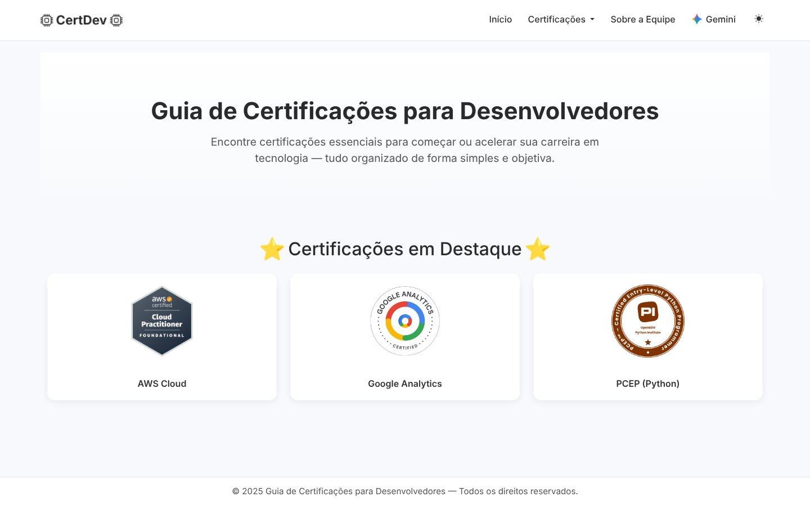
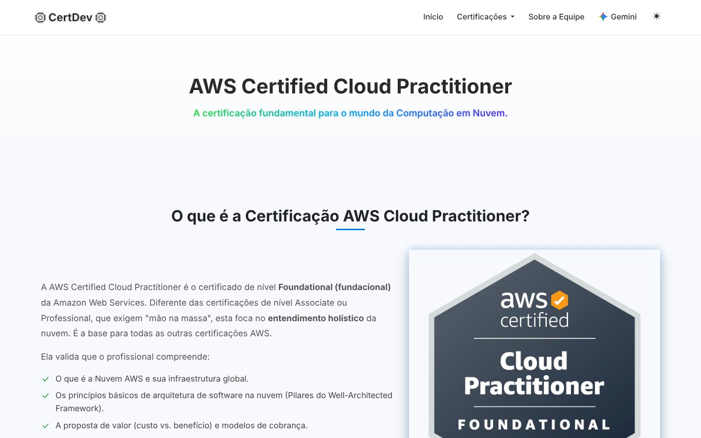
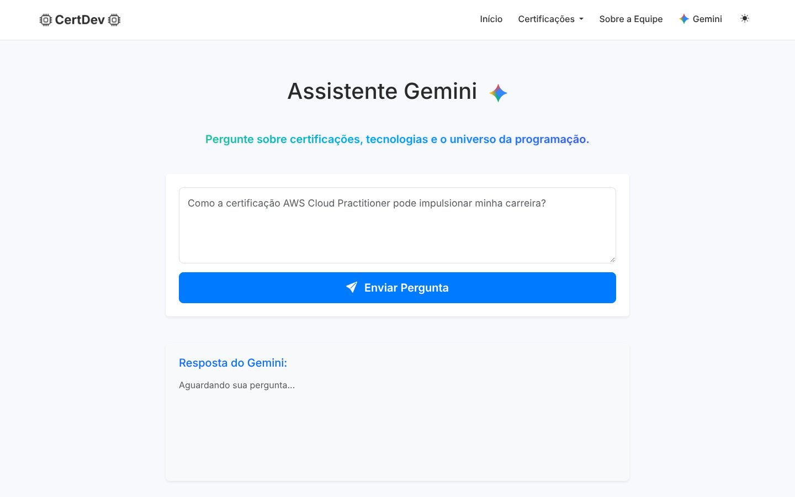

# CertDev: Certifications Guide for Developers

A website that helps developers choose their first certifications, with a guide page for each one and an AI assistant powered by Google Gemini. University team project at UNIESP, where I was the **project leader** of a team of 6.

**Live site:** coming soon



## Features

- **Home page** with the featured certifications: AWS Certified Cloud Practitioner, Google Analytics and PCEP (Python).
- **One guide page per certification:** what it is, what it validates, and who it is for.
- **Gemini assistant:** the user asks a question about certifications and the Gemini API answers in Markdown.
- **Team page** with each member and their role.
- **Light and dark theme** and a responsive layout with Bootstrap.

**Certification page:**



**Gemini assistant:**



## Tech stack

- **Back-end:** Python, Flask, Jinja2 templates.
- **AI:** Google Gemini API (`gemini-2.5-flash`) with a custom system prompt.
- **Front-end:** HTML, CSS, Bootstrap, JavaScript.

## Project structure

```
.
├── app.py               # Flask app: routes and the Gemini assistant
├── templates/           # Jinja2 pages (home, certifications, team, Gemini)
├── public/static/       # CSS and images (served by the CDN on Vercel)
├── tests/test_app.py    # automated tests with pytest
├── docs/screenshots/    # images used in this README
├── requirements.txt     # dependencies to run the site
├── requirements-dev.txt # dependencies to run the tests
└── .env.example         # template for the Gemini API key
```

## How to run

```bash
pip install -r requirements.txt
cp .env.example .env    # then put your Gemini key inside .env
python app.py
```

Open `http://127.0.0.1:5000`. The pages work without a key. Only the Gemini assistant needs it.

## Tests

```bash
pip install -r requirements-dev.txt
pytest
```

The tests check that every page opens, that the assistant handles empty questions and a missing key, that HTML coming from the AI is blocked, and that internal errors are never shown to visitors.

## Deploy

The site is ready for [Vercel](https://vercel.com): it finds the `app` in `app.py` automatically, with no extra configuration. The only setting needed is the `GEMINI_API_KEY` environment variable in the project settings.

## Team

- **Carlos Alberto da Silva Neto, project leader:** team management, organization and planning.
- **Isaac Lima de Carvalho, back-end developer:** Flask app, routes and Gemini API integration.
- **Guilherme de Santana Silva, front-end developer:** Bootstrap base layout and page templates.
- **José Alex Diniz de Oliveira, front-end developer:** navigation bar and footer.
- **Lucas Gomes de Araújo, content developer:** research and content about the certifications.
- **Gustavo de Oliveira Marques, content developer:** content structure and page texts.

Academic project for the Computer Science course at UNIESP, under the guidance of Professor Messias (2025).

---

**Versão em português:** guia de certificações para desenvolvedores, feito em equipe na UNIESP. Tem uma página para cada certificação (AWS Cloud Practitioner, Google Analytics e PCEP) e um assistente com a API do Gemini. Fui o líder do projeto, numa equipe de 6 pessoas. Stack: Python, Flask, Bootstrap e Gemini API.
